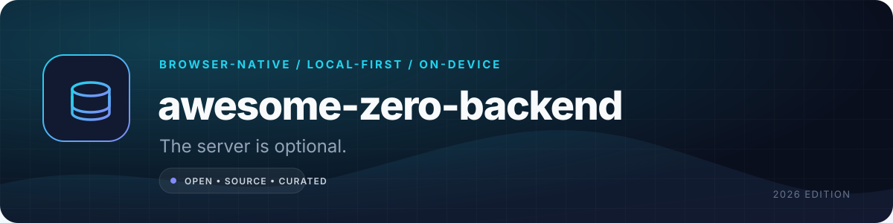

  

<h1 align="center">awesome-zero-backend</h1>

  <strong>A curated map of tools that let the browser do the backend's job.</strong> 
  WASM, local-first data, on-device AI, offline storage, media processing, and peer-to-peer sync.

  <a href="#quick-paths">Quick paths</a> •
  <a href="#the-catalog">Catalog</a> •
  <a href="#when-you-still-need-a-server">Reality check</a> •
  <a href="CONTRIBUTING.md">Contribute</a>

  
  
  

> **The premise:** a surprising amount of "backend" work is really data storage, file conversion, search, inference, or state synchronization. Modern browsers can now do those jobs locally. This repository maps the tools that make it practical — and is honest about the jobs that still need a server.

## Why this list exists

"Zero backend" does not mean "no infrastructure." It means the expensive, stateful part of your product runs on the user's device instead of a machine you rent. That changes the cost model, the privacy story, and the failure modes.

Use this list when you want to:

- Ship a useful product without operating a database or queue.
- Keep working documents on-device and sync only when needed.
- Cut cloud egress and transcoding bills.
- Build offline-first software that feels instant.
- Prototype AI features without sending every keystroke to an API.

## Quick paths

| If you are building… | Start with | Why |
|---|---|---|
| An offline-first notes app | [TinyBase](https://github.com/tinyplex/tinybase) or [Yjs](https://github.com/yjs/yjs) + [Dexie](https://github.com/dexie/Dexie.js) + [Workbox](https://github.com/GoogleChrome/workbox) | Reactive local state, durable storage, and a controllable service worker. |
| A SQL analytics dashboard | [DuckDB-WASM](https://github.com/duckdb/duckdb-wasm) + [OPFS](https://developer.mozilla.org/en-US/docs/Web/API/File_System_API/Origin_private_file_system) | Columnar queries over Parquet/CSV without uploading the dataset. |
| A local Postgres playground | [PGlite](https://github.com/electric-sql/pglite) | Real Postgres semantics in a WASM build, including extensions. |
| A private document assistant | [Transformers.js](https://github.com/huggingface/transformers.js) or [WebLLM](https://github.com/mlc-ai/web-llm) + [PDF.js](https://github.com/mozilla/pdf.js) | Embeddings, extraction, and generation can stay on-device. |
| A browser video editor | [WebCodecs](https://developer.mozilla.org/en-US/docs/Web/API/WebCodecs_API) + [MediaBunny](https://github.com/Vanilagy/mediabunny) | Hardware-accelerated decode/encode without a transcoding server. |
| A peer-to-peer file drop | [WebRTC](https://developer.mozilla.org/en-US/docs/Web/API/WebRTC_API) + [Trystero](https://github.com/dmotz/trystero) | Direct transfer; the signaling layer can be tiny or serverless. |
| A static documentation search | [Pagefind](https://github.com/Pagefind/pagefind) | Build-time index, tiny runtime, no search cluster. |
| A Git client in the browser | [isomorphic-git](https://github.com/isomorphic-git/isomorphic-git) + [LightningFS](https://github.com/isomorphic-git/lightning-fs) | Clone, commit, and push against a filesystem backed by the browser. |

## The catalog

**Legend:** `B` = browser, `P2P` = peer-to-peer, `B+E` = browser with an optional edge component, `N` = Node/CLI. Licences are SPDX identifiers from the upstream project; the linked service may have separate terms.

### Local databases and sync

| Project | Replaces | What you get | Runs | License |
|---|---|---|---|---|
| [PGlite](https://github.com/electric-sql/pglite) | Hosted Postgres for local-first apps | A WASM Postgres with a familiar SQL surface and extension support. | B, N | Apache-2.0 |
| [SQLite WASM](https://sqlite.org/wasm/doc/trunk/index.md) | A remote SQL database | The official SQLite build for the browser, with OPFS persistence. | B | Public domain |
| [sql.js](https://github.com/sql-js/sql.js) | A small embedded database | SQLite compiled to WASM; simple import/export of the whole database file. | B, N | MIT |
| [wa-sqlite](https://github.com/rhashimoto/wa-sqlite) | SQLite with browser storage | A WASM SQLite build with pluggable VFS backends, including OPFS. | B | MIT |
| [DuckDB-WASM](https://github.com/duckdb/duckdb-wasm) | A warehouse for local analytics | Analytical SQL over CSV, JSON, Parquet, and Arrow data. | B | MIT |
| [Dexie](https://github.com/dexie/Dexie.js) | A remote CRUD API | A thoughtful IndexedDB wrapper with transactions, live queries, and schema upgrades. | B | Apache-2.0 |
| [idb](https://github.com/jakearchibald/idb) | Boilerplate IndexedDB code | A tiny promise-based IndexedDB wrapper that stays close to the platform. | B | ISC |
| [localForage](https://github.com/localForage/localForage) | A key-value store | An async storage API with IndexedDB, WebSQL, and localStorage fallbacks. | B | Apache-2.0 |
| [RxDB](https://github.com/pubkey/rxdb) | A realtime database service | Reactive local documents, replication plugins, and conflict handling. | B, N | Apache-2.0 |
| [PouchDB](https://github.com/pouchdb/pouchdb) | CouchDB-backed offline sync | A CouchDB-compatible database that syncs when connectivity returns. | B, N | Apache-2.0 |
| [TinyBase](https://github.com/tinyplex/tinybase) | A state manager plus database | Reactive tabular/key-value state with persistence and synchronization adapters. | B, N | MIT |
| [ElectricSQL](https://github.com/electric-sql/electric) | A sync API for Postgres | A read-path sync engine that streams Postgres shapes into local clients. | B+E | Apache-2.0 |
| [Jazz](https://github.com/garden-co/jazz) | A backend for collaborative state | Local-first documents, permissions, and sync with a small client runtime. | B+E | MIT |
| [Automerge](https://github.com/automerge/automerge) | Manual conflict resolution | CRDT documents that merge concurrent edits deterministically. | B, N | MIT |
| [Yjs](https://github.com/yjs/yjs) | A custom realtime protocol | A mature CRDT ecosystem for shared text, maps, arrays, and awareness. | B, N, P2P | MIT |
| [Loro](https://github.com/loro-dev/loro) | A custom CRDT implementation | A fast CRDT library with rich text, movable lists, and versioning. | B, N | MIT |
| [cr-sqlite](https://github.com/vlcn-io/cr-sqlite) | Hand-written merge logic | CRDT semantics for SQLite tables, including multi-writer convergence. | B, N | Apache-2.0 |

### On-device AI

| Project | Replaces | What you get | Runs | License |
|---|---|---|---|---|
| [Transformers.js](https://github.com/huggingface/transformers.js) | A hosted inference API for classic NLP/vision models | ONNX-backed pipelines for embeddings, classification, ASR, vision, and small LLMs. | B, N | Apache-2.0 |
| [WebLLM](https://github.com/mlc-ai/web-llm) | A hosted chat completion endpoint | GPU-accelerated LLM inference in the browser through WebGPU. | B | Apache-2.0 |
| [ONNX Runtime Web](https://onnxruntime.ai/docs/tutorials/web/) | A model-serving container | Runs ONNX models with WebGPU, WebGL, or WASM execution providers. | B | MIT |
| [MediaPipe Tasks](https://github.com/google-ai-edge/mediapipe) | A vision/audio inference service | Ready-made face, hand, pose, gesture, and audio tasks. | B, N | Apache-2.0 |
| [TensorFlow.js](https://github.com/tensorflow/tfjs) | A Python model server | Train and run models in JavaScript with WebGL/WebGPU/WASM backends. | B, N | Apache-2.0 |
| [ml5.js](https://github.com/ml5js/ml5-library) | A computer-vision API | Friendly wrappers over pre-trained models for creative and educational work. | B | Apache-2.0 |
| [wllama](https://github.com/ngxson/wllama) | A llama.cpp server | A focused WASM binding for GGUF inference in the browser. | B, N | MIT |
| [llama.cpp](https://github.com/ggml-org/llama.cpp) | A GPU inference cluster | Efficient local inference across CPU, Metal, CUDA, Vulkan, and WASM. | B, N | MIT |
| [whisper.cpp](https://github.com/ggml-org/whisper.cpp) | A speech-to-text API | Local Whisper inference, including a WASM target. | B, N | MIT |
| [Piper](https://github.com/rhasspy/piper) | A hosted text-to-speech API | Fast, small neural TTS voices that can run on CPU. | B, N | MIT |
| [Tesseract.js](https://github.com/naptha/tesseract.js) | A cloud OCR endpoint | OCR for images and PDFs in the browser, with language packs. | B, N | Apache-2.0 |
| [WebGPU](https://gpuweb.github.io/gpuweb/) | A GPU compute server | The browser's modern graphics/compute API; the foundation for local inference and rendering. | B | W3C standard |

### Media, documents, and files

| Project | Replaces | What you get | Runs | License |
|---|---|---|---|---|
| [FFmpeg.wasm](https://github.com/ffmpegwasm/ffmpeg.wasm) | A cloud transcoding queue | FFmpeg in the browser for trim, convert, overlay, and audio jobs. Check codec licensing. | B | MIT wrapper; FFmpeg LGPL/GPL |
| [MediaBunny](https://github.com/Vanilagy/mediabunny) | A media processing service | A modern, tree-shakeable media toolkit built on WebCodecs. | B, N | MPL-2.0 |
| [WebCodecs](https://developer.mozilla.org/en-US/docs/Web/API/WebCodecs_API) | Server-side transcoding | Low-level access to hardware codecs for frame-accurate editing and streaming. | B | Web standard |
| [PDF.js](https://github.com/mozilla/pdf.js) | A PDF rendering service | Mozilla's PDF renderer, including text extraction and annotation layers. | B, N | Apache-2.0 |
| [pdf-lib](https://github.com/Hopding/pdf-lib) | A PDF manipulation API | Create, merge, split, rotate, and fill PDFs without a server round trip. | B, N | MIT |
| [Squoosh](https://github.com/GoogleChromeLabs/squoosh) | An image optimisation service | Codec lab and CLI for compressing images with WASM codecs. | B, N | Apache-2.0 |
| [browser-image-compression](https://github.com/Donaldcwl/browser-image-compression) | Upload-side image resizing | Resize and compress images before upload, with Web Worker support. | B | MIT |
| [Jimp](https://github.com/jimp-dev/jimp) | A server-side image pipeline | Pure JavaScript image manipulation with no native dependencies. | B, N | MIT |
| [heic2any](https://github.com/alexcorvi/heic2any) | A HEIC conversion API | Converts HEIC/HEIF images to JPEG/PNG in the browser. | B | MIT |
| [SheetJS](https://github.com/SheetJS/sheetjs) | A spreadsheet conversion service | Read and write XLSX, XLS, CSV, and other spreadsheet formats. | B, N | Apache-2.0 |
| [Papa Parse](https://github.com/mholt/PapaParse) | A CSV ingestion endpoint | Fast, streaming CSV parsing with worker support. | B, N | MIT |
| [JSZip](https://github.com/Stuk/jszip) | A zip/unzip API | Create and read ZIP archives in JavaScript. | B, N | MIT or GPL-3.0 |
| [fflate](https://github.com/101arrowz/fflate) | A compression service | Very small, fast DEFLATE/gzip/ZIP implementation for the browser. | B, N | MIT |
| [docx](https://github.com/dolanmiu/docx) | A document-generation service | Generate .docx files from JavaScript with tables, images, and styles. | B, N | MIT |
| [ExcelJS](https://github.com/exceljs/exceljs) | A reporting backend | Read/write XLSX workbooks, formulas, styles, and streaming rows. | B, N | MIT |
| [libarchive.js](https://github.com/nika-begiashvili/libarchivejs) | A server-side archive extractor | Extract 7z, RAR, TAR, and ZIP archives in a Web Worker. | B | MIT |

### Storage, offline, and caching

| Project | Replaces | What you get | Runs | License |
|---|---|---|---|---|
| [Origin Private File System](https://developer.mozilla.org/en-US/docs/Web/API/File_System_API/Origin_private_file_system) | A mounted disk | A private, persistent filesystem with fast random access and large quotas. | B | Web standard |
| [Cache Storage](https://developer.mozilla.org/en-US/docs/Web/API/CacheStorage) | A CDN cache you manage | Programmable response storage for offline shells and assets. | B | Web standard |
| [Workbox](https://github.com/GoogleChrome/workbox) | A custom service worker | Production-grade precaching, routing, expiration, and background sync. | B | MIT |
| [vite-plugin-pwa](https://github.com/vite-pwa/vite-plugin-pwa) | A hand-written PWA build | Generates a service worker and manifest from a Vite app. | B | MIT |
| [Serwist](https://github.com/serwist/serwist) | Workbox boilerplate | A modern service-worker toolkit with Next.js and framework integrations. | B | MIT |
| [BrowserFS](https://github.com/jvilk/BrowserFS) | A POSIX filesystem | A filesystem abstraction over IndexedDB, OPFS, HTTP, and in-memory backends. | B | MIT |
| [LightningFS](https://github.com/isomorphic-git/lightning-fs) | A local disk for a browser app | A small filesystem designed for isomorphic-git and persistent browser storage. | B | MIT |
| [isomorphic-git](https://github.com/isomorphic-git/isomorphic-git) | A Git server for simple workflows | A pure JavaScript Git implementation that runs in Node and the browser. | B, N | MIT |
| [BroadcastChannel](https://developer.mozilla.org/en-US/docs/Web/API/BroadcastChannel) | A message broker between tabs | Native same-origin messaging across tabs, windows, and workers. | B | Web standard |

### Search and local data tools

| Project | Replaces | What you get | Runs | License |
|---|---|---|---|---|
| [Pagefind](https://github.com/Pagefind/pagefind) | Algolia for static sites | A build-time full-text index with a tiny, lazy-loaded browser runtime. | B | MIT |
| [Orama](https://github.com/oramasearch/orama) | A hosted search API | Full-text, vector, and hybrid search with a small JavaScript footprint. | B, N | Apache-2.0 |
| [MiniSearch](https://github.com/lucaong/minisearch) | A search cluster for small corpora | An in-memory full-text index with prefix search and field boosting. | B, N | MIT |
| [FlexSearch](https://github.com/nextapps-de/flexsearch) | A server-side search index | Fast full-text indexing with a flexible tokenizer and persistent indexes. | B, N | Apache-2.0 |
| [Lunr.js](https://github.com/olivernn/lunr.js) | A documentation search backend | A proven client-side index for docs and small content sites. | B, N | MIT |
| [Fuse.js](https://github.com/krisk/Fuse) | Fuzzy-search infrastructure | Lightweight approximate string matching for commands, docs, and lists. | B, N | Apache-2.0 |
| [Apache Arrow JS](https://github.com/apache/arrow-js) | A data serialization service | Columnar in-memory data and zero-copy interchange with Arrow/Parquet tooling. | B, N | Apache-2.0 |
| [Arquero](https://github.com/uwdata/arquero) | A SQL warehouse for small data | Relational transformations and aggregation over JavaScript data. | B, N | BSD-3-Clause |

### Peer-to-peer and collaboration

| Project | Replaces | What you get | Runs | License |
|---|---|---|---|---|
| [WebRTC](https://developer.mozilla.org/en-US/docs/Web/API/WebRTC_API) | A media relay for direct calls | Encrypted, low-latency audio, video, and data channels between peers. | B, P2P | Web standard |
| [PeerJS](https://github.com/peers/peerjs) | A custom WebRTC signaling layer | A small peer abstraction with a configurable signaling server. | B, P2P | MIT |
| [Trystero](https://github.com/dmotz/trystero) | A realtime collaboration server | WebRTC rooms that use BitTorrent, Nostr, MQTT, or IPFS for signaling. | B, P2P | MIT |
| [WebTorrent](https://github.com/webtorrent/webtorrent) | A file-sharing backend | BitTorrent in the browser, including streaming and peer discovery. | B, P2P | MIT |
| [js-libp2p](https://github.com/libp2p/js-libp2p) | A custom P2P networking stack | Modular transport, encryption, discovery, and pubsub primitives. | B, N, P2P | Apache-2.0 or MIT |
| [Helia](https://github.com/ipfs/helia) | A centralized content store | A modern IPFS implementation for content-addressed data in JavaScript. | B, N, P2P | Apache-2.0 or MIT |
| [OrbitDB](https://github.com/orbitdb/orbitdb) | A decentralized database service | Peer-to-peer databases built on IPFS and CRDTs. | B, N, P2P | MIT |
| [Gun](https://github.com/amark/gun) | A realtime graph database | A decentralized, offline-first graph store with conflict handling. | B, N, P2P | MIT |
| [Hypercore](https://github.com/holepunchto/hypercore) | An append-only event service | Signed, replicated append-only logs for peer-to-peer data. | N, P2P | MIT |
| [y-webrtc](https://github.com/yjs/y-webrtc) | A hosted Yjs provider | WebRTC-based Yjs sync with encrypted room signaling. | B, P2P | MIT |

### Compute and language runtimes

| Project | Replaces | What you get | Runs | License |
|---|---|---|---|---|
| [WebAssembly](https://webassembly.org/) | A native binary distribution pipeline | A portable bytecode target for C/C++, Rust, Go, and more. | B, N | W3C standard |
| [Pyodide](https://github.com/pyodide/pyodide) | A Python execution service | CPython and scientific packages compiled to WASM. | B, N | MPL-2.0 |
| [JupyterLite](https://github.com/jupyterlite/jupyterlite) | A hosted notebook server | Static Jupyter notebooks that run in the browser. | B | BSD-3-Clause |
| [Emscripten](https://github.com/emscripten-core/emscripten) | A native-to-server port | The mature LLVM-to-WASM toolchain, including filesystem and browser bindings. | Build | MIT/UIUC |
| [wasm-bindgen](https://github.com/rustwasm/wasm-bindgen) | Glue code for a Rust service | Rust/JavaScript bindings and browser APIs for WASM modules. | Build | Apache-2.0 or MIT |
| [AssemblyScript](https://github.com/AssemblyScript/assemblyscript) | TypeScript-to-server compilation | A TypeScript-like language that compiles to small WASM modules. | Build | Apache-2.0 |
| [Extism](https://github.com/extism/extism) | A plugin sandbox service | A portable WASM plugin system with host functions. | B, N | BSD-3-Clause |
| [Container2wasm](https://github.com/container2wasm/container2wasm) | A container host | Converts container images into WASM images that can run in compatible runtimes. | Build, N | Apache-2.0 |
| [WebContainers](https://webcontainers.io/) | A cloud development VM | A full Node.js environment in the browser (commercial licence). | B | Proprietary |
| [CheerpX](https://leaningtech.com/cheerpx/) | A remote Linux sandbox | x86 virtualization in the browser for Linux binaries (commercial terms). | B | Proprietary |

### Glue for client-side architecture

| Project | Replaces | What you get | Runs | License |
|---|---|---|---|---|
| [Comlink](https://github.com/GoogleChromeLabs/comlink) | A custom worker RPC layer | Makes Web Workers feel like local async objects. | B | Apache-2.0 |
| [Partytown](https://github.com/QwikDev/partytown) | A tag-manager proxy | Moves third-party scripts into a worker and off the main thread. | B | MIT |
| [MSW](https://github.com/mswjs/msw) | A mock API server | Intercepts requests in the browser or Node for tests and local development. | B, N | MIT |
| [TanStack Query](https://github.com/TanStack/query) | A cache server for client state | Async state, caching, retries, and invalidation without a data-fetching framework. | B, N | MIT |
| [Zustand](https://github.com/pmndrs/zustand) | A client-state backend | A tiny, unopinionated store for local UI and domain state. | B, N | MIT |

## When you still need a server

Zero-backend is a design constraint, not a religion. These jobs still need a trusted machine you control or a specialist provider:

| Job | Why the browser is not enough | Sensible compromise |
|---|---|---|
| Sending email | A browser cannot deliver mail reliably; spam controls need server identity. | Use a transactional email API with a tiny serverless function. |
| Payments and entitlements | Webhooks and secret keys must never reach the client. | Hosted checkout + a minimal webhook receiver. |
| Authentication for shared data | Passkeys are great, but recovery, revocation, and authorization need a trusted authority. | Managed auth or a small edge function. |
| Large uploads and backups | Browser quotas vary and can be evicted; users expect cross-device recovery. | Object storage with signed URLs. |
| Scheduled jobs | A closed tab cannot run a cron job. | Edge scheduler or a small worker. |
| Push notifications | Delivery requires a push service and server-side keys. | Web Push service or managed notifications. |
| Models above laptop scale | VRAM, thermals, and download size make huge models impractical. | Local small model + optional cloud fallback. |
| Regulated data | Retention, audit, and residency requirements may prohibit device-only storage. | Server-side controls and legal review. |

**Rule of thumb:** keep the *interactive working set* on-device; put *irreversible, shared, or trusted* operations behind a small server.

## How entries are selected

- The project must have a clear browser, local-first, or peer-to-peer execution path.
- The official documentation or repository must be reachable and maintained enough to evaluate.
- "Zero backend" must be a real deployment option, not just a marketing phrase.
- Commercial and closed-source tools are allowed only when they are the practical option, and are labelled.
- Metrics, prices, and licences are checked against the upstream project at review time. They change; open an issue with a source if something is stale.

## Contributing

Found a tool that removes a backend dependency? Read [CONTRIBUTING.md](CONTRIBUTING.md) and open a pull request. One well-sourced entry is more useful than ten unsourced ones.

## License

Original catalog text and structure are released under the [MIT License](LICENSE). Linked projects, names, and logos remain the property of their respective owners. Licence labels are informational and are not legal advice.

---

**Last reviewed: 2026-11-03.** Prices, metrics, licences, and availability change; verify against the linked upstream source before relying on them.
